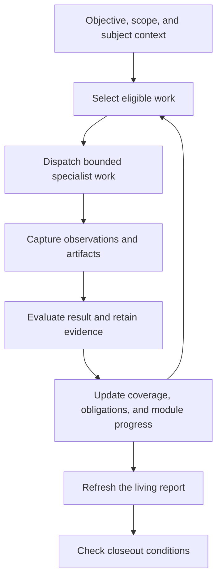
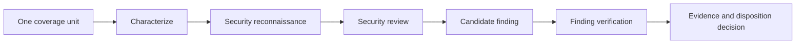
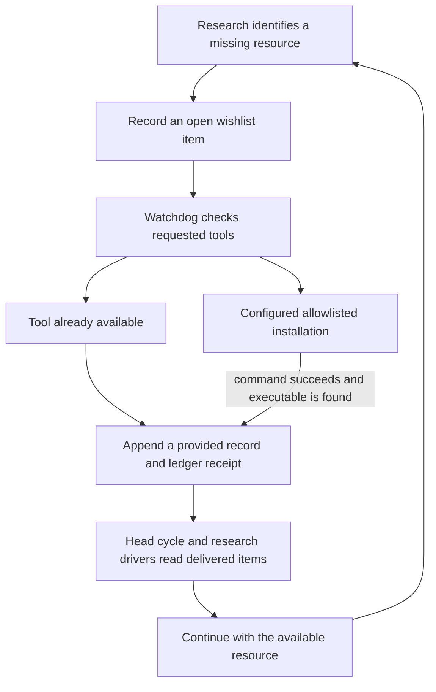

# REFALL AB

**Persistent research loops for source code, binaries, and evidence.**

REFALL AB coordinates specialist agents around a shared research workbench.
It turns a subject into bounded work, records what each worker examined, and preserves the evidence behind each conclusion.
A subject can continue across many conversations, interrupted workers, report revisions, and manager sessions.

The operator defines the objective and scope.
The manager selects work and execution resources.
Specialists inspect source, examine binaries, build harnesses, challenge claims, or compile reports.
The workbench stores context, coverage, facts, leads, findings, artifacts, and outstanding decisions.

[More Info](https://gainsec.github.io/ReadyArmor-Reverse-Engineer-For-All-REFALL/)

## Why the design is distinctive

A long investigation must retain more than its latest answer.
It must preserve which material was examined, why a conclusion was accepted, and which questions remain open.
REFALL makes those records part of the research system.

The subject owns the state.
Workers receive bounded assignments, contribute observations, and return results through defined record paths.
Later work can reuse the inventory, determinations, artifacts, finding history, and unresolved obligations after a conversation ends or a manager restarts.

The distinctive design connects four decisions:

| Decision | Mechanism | Why it matters |
| --- | --- | --- |
| What should run next? | Coverage claims, target-local module progress, and pending-action priority. | Broad examination and focused follow-up share the same campaign. |
| What authority was granted? | Scoped capability records and a backend launch caller that obeys broker refusal. | An assignment and permission to perform an action remain separate decisions. |
| What conclusion is supported? | Captured evidence, finding admission, and typed disposition receipts. | A worker's narrative does not silently become an accepted finding state. |
| What counts as finished? | Separate worker, module, report, and closeout conditions. | Captured output, an idle loop, and campaign completion have different meanings. |

These mechanisms reinforce each other through shared records.
An interrupted worker can leave useful evidence without completing its assignment.
A rejected or deferred finding can retain its proof and next obligation.
A later worker or configured provider can extend that work without replacing the subject's history.

REFALL applies the Ready Armor approach at the campaign and evidence boundaries.
Control in Depth separates the decisions; persistent records keep their results available to later workers and operators.
These campaign controls run in backend services on the deployment host.
Their enforcement comes from API admission, database transactions, authorization decisions, and checked record transitions.
They do not require a virtual machine or container as their security foundation.

For example, backend Start and Update refuse an unauthorized launch before the new loop process starts.
Finding admission and disposition routes also evaluate stored evidence and receipt requirements independently of the worker's prompt.
The host supplies filesystem, network, and process permissions for tools that run directly.
REFALL controls campaign decisions and evidence acceptance; direct specialist commands use the execution environment's permissions.
Read [Ready Armor in REFALL](docs/ready-armor.md) for the composition, practical value, and implementation paths.

## What REFALL does

A research campaign needs more than a sequence of agent replies.
It needs a measured examination surface, clear ownership, reusable observations, and an explicit account of unfinished work.
REFALL supplies those records and connects them to execution.

| Capability | Result for the operator |
| --- | --- |
| Subject workbenches | Context, evidence, decisions, and reports remain together for each target. |
| Evidence ledger | Facts, leads, findings, validation, artifacts, and operator decisions remain queryable after a worker ends. |
| Resource wishlist | Missing tools or access become recorded requests, with provided records and delivery receipts. |
| Source inventory | File identities and coverage units define the recorded examination surface. |
| Work modules | Research, decomposition, review, harness creation, and verification can share one subject. |
| Specialist lanes | Reasoning, implementation, and verification work can use different providers. |
| Continuous evidence capture | Results appear while workers run and survive incomplete conversations. |
| Finding gates | Promotion, rejection, duplicates, and deferral retain their supporting evidence. |
| Scoped capabilities | Grants control requests presented to the broker; backend loop launch obeys its decision. |
| Persistent obligations | Missing access, failed output, and unanswered scope decisions remain visible. |
| Run continuity | Active work, module progress, checkpoints, and shared notes survive a manager restart. |
| Evidence graph | Recorded observation nodes and supplied relationship data form an inspectable evidence map. |
| Campaign supervision | Liveness checks, progress review, recovery limits, and configured usage ceilings support long campaigns. |
| Living reports | Findings, architecture, runtime proof, and analyst notes develop with the research. |
| Mechanical closeout | The operator can inspect exactly which conditions prevent completion. |

## Research runs in connected cycles

REFALL separates the campaign, the target-specific work, and each specialist conversation.
A campaign can continue while individual workers finish, retry, or wait for a decision.
The next assignment uses recorded state and the enabled module definitions.



### The campaign cycle

The standing loop fills available worker slots, polls active conversations, captures new evidence, updates reports, and saves run state.
A polling cycle can collect partial output while a worker remains active.
Worker completion has a separate outcome decision.

The scheduler selects the next task in this order:

1. Claim an eligible pending action.
2. Handle threat-model work and eligible subject-level setup modules.
3. Claim a fresh coverage unit when breadth work is enabled.
4. Select eligible finding work, such as verification or a patch proposal.
5. Select later module work on previously examined units.

Dependencies apply to each target.
A component can enter review while another component still needs its first examination.
The default registry enables security assessment and adds its required characterization dependency.
Select the `baseline` pack explicitly for characterization-only work.

### The target-specific cycle

The security assessment pack connects characterization, reconnaissance, and review for each coverage unit.
Finding-specific verification uses the findings produced by the research.



Other packs add reverse engineering, general research, development, or toolchain work.
A subject can combine packs and add custom modules with their own objectives and dependencies.
The development pack includes a finding-scoped patch proposal.
Patch verification requires the corresponding workflow configuration or assigned follow-up work.

Built-in modules run once per target.
A custom module can set `once_per_target: false` to permit repeated eligible work.
A pending action can request a focused investigation when a result needs more proof or an operator decision.

### The worker and supervision cycles

Each specialist receives a bounded task and an output contract.
While it runs, REFALL can ingest facts, leads, findings, flows, and workspace artifacts.
At termination, the executor retains useful evidence before it handles failure, retry, or successful completion.
A failed conversation can contribute observations without completing its coverage unit.

The watchdog reviews services, progress, dependencies, and configured runtime, token, and cost limits.
The supervisor combines frequent liveness checks with broader review and bounded recovery.
A coordinator cycle limit controls polling work; active worker state can remain available for a later continuation.
Repeated recovery can end in an operator hold.

Read [Research cycles](docs/research-cycles.md) for the exact scheduling, retry, completion, and closeout paths.
Open [the interactive cycle maps](docs/index.html#walkthroughs) to inspect the nodes and their source references.

## The ledger is the campaign's research journal

The subject ledger preserves evidence and decisions outside the current conversation.
Entries can record facts, leads, findings, validation, artifacts, runtime events, capability decisions, pending actions, and closeout results.
Each appended record receives an identifier and timestamps when those fields are absent.

The workbench stores the ledger as append-only JSONL.
Queries can filter entries by kind, specialist lane, severity, and time.
Statistics summarize the recorded kinds, lanes, and severities.
This gives a replacement manager a durable account of what was examined, what changed, and why.

The Ops panel exposes a Ledger view and an Output view.
Output compiles selected research records from the ledger.
The report compiler also reads ledger entries and statistics alongside coverage and runtime state.
A later report can therefore reuse earlier observations, validation, and artifact references.

Finding acceptance, coverage completion, and ledger capture have separate responsibilities.
The finding gates validate accepted conclusions.
Coverage tracks examined units and their determinations.
The ledger retains the evidence and decision history behind those records.

Sources: [ledger storage](arcticbase/backend/src/arctic_base/refall/ledger.py#L36), [ledger API](arcticbase/backend/src/arctic_base/api/refall_ledger.py#L14), [Ops panel](arcticbase/frontend/src/lib/refall/WorkbenchOpsPanel.svelte#L953).

## The wishlist turns missing resources into visible requests

A specialist can record a missing tool, dependency, access requirement, or other research need in the subject wishlist.
The request carries its kind, item, reason, requester, and status.
This preserves the need for the next operator or worker.



For supported tool requests, the watchdog checks whether the executable is already available on its host.
When installation is enabled, it can run a fixed installer command for an allowlisted tool.
The current installer table covers Binwalk, ExifTool, radare2, Rizin, and YARA, including the configured command aliases.
Successful installation must also pass an executable availability check.

Delivery appends a separate `provided` wishlist row.
An `ops-event` ledger entry links the original request, the provided record, and the delivery receipt.
The original open request remains in history.
The watchdog skips matching tools that already have a provided record.

The head orchestrator reads provided items for each head cycle.
The research driver and three binary drivers load delivered items at startup and include that snapshot in their worker objectives.
Their instructions tell workers to use delivered resources before requesting duplicates.
Other resource needs remain available for operator handling.
Host installation and worker-container availability are distinct deployment steps.

### Wishes, obligations, and authority

| Record | What it controls |
| --- | --- |
| Wishlist item | A requested or provided research resource. |
| Pending action | An unfinished obligation, with ownership, status, and any required resolution receipt. |
| Capability request | A request for permission to perform an action class. |
| Capability grant | The scope and conditions checked by the authorization broker. |
| Coverage claim | A worker's lease on an examination unit. |

The standing loop claims eligible pending actions before ordinary research work.
An operator decision, fulfilled dependency, and authorized action each retain their own records.
Use the corresponding resolution and grant paths to make blocked work eligible again.

Read [Ledger and wishlist](docs/ledger-and-wishlist.md) for request examples, API paths, delivery behavior, and the two dashboard interfaces.

## Persistent memory connects the cycles

REFALL maintains several records because each answers a different operational question.

| Record | Question it answers |
| --- | --- |
| Subject context and scope | What are we examining, and under which boundaries? |
| Source inventory and coverage | Which exact files and units have been examined? |
| Ledger | What evidence and decisions have accumulated? |
| Blackboard | Which compact shared notes should later tasks receive? |
| Module progress | Which passes have completed for each target? |
| Wishlist | Which resources were requested or provided? |
| Pending actions | Which obligations still need work or a decision? |
| Runtime observations and evidence graph | Which observations and supplied relationships were recorded? |
| Run manifest and checkpoints | Which providers, resources, inputs, and active work belong to this run? |
| Living report and analyst notes | What does the accumulated research explain so far? |

A manager restart can recover active conversations and module progress from stored state.
Resume preflight compares recorded input hashes before it continues active work.
Artifacts and archived conversations preserve details beyond a compact summary.
The evidence graph exposes recorded nodes and supplied relationships.
Call graphs and other code-analysis graphs remain separate tool outputs.

## What the architecture combines

**Coverage and investigation serve different purposes.**
Coverage records which units were examined.
Research follows concrete leads across callers, parsers, boundaries, and observed behavior.
The two records let an operator distinguish broad examination from deeper proof.

**Work belongs to the subject.**
The loop builds each task from stored context, scope, shared notes, its target, and an output contract.
A replacement worker can read earlier determinations and artifacts before it extends the work.
Expensive decompilation or source analysis can become reusable input for later passes.

**Evidence collection continues during execution.**
REFALL reads agent-authored event messages and structured files in the worker workspace.
It captures facts, leads, findings, and flow relationships while the conversation remains active.
At termination, it also preserves useful results from interrupted or malformed output.
Successful completion requires a separate decision.

**Negative conclusions also require evidence.**
A finding cannot disappear through an unsupported false-positive or duplicate decision.
Typed receipts record why the transition was accepted or refused.
Source hashes can bind that proof to the files that were examined.

**Publication has its own state.**
A current report has an explicit workbench object identifier.
Report replacement checks preserve populated technical sections.
Closeout examines unresolved obligations, proof, finding decisions, expired claims, and report freshness.

## Who uses it

| Audience | Typical use |
| --- | --- |
| Security researchers | Trace candidate vulnerabilities from source or binary anchors to review and runtime proof. |
| Reverse engineers | Build an accumulating map of components, interfaces, functions, and data flow. |
| Engineering reviewers | Combine source examination, harness proposals, verification, and remediation work. |
| Research operators | Coordinate long campaigns with bounded workers, reusable artifacts, and visible decisions. |

For a firmware subject, the useful output can include a component inventory, function observations, validation requests, and a reproducible finding package.
For a source repository, it can include per-file determinations, architecture facts, review results, and a prioritized research frontier.
For a mapping task, facts, leads, and flow records can build a technical codex without vulnerability findings.

## Ready Armor design approach

The Ready Armor approach separates agent capability from operational authority.
It also treats the provenance of a claim as a separate control concern.
REFALL applies these ideas to research coordination: bounded assignments, recorded authority, durable evidence, explicit decisions, and reportable completion.

BRA provides a governed assessment architecture.
ARA provides an agent runtime and policy substrate.
REFALL provides a research campaign loop and evidence workbench.
Their public architectures describe related control principles; REFALL's code supplies its own scheduler, result contracts, and decision gates.
The control stack starts with configured source resources and execution permissions.
Source projection prepares the container location; inventory records content identity.
The broker then checks presented action requests against applicable grants.
Backend Start and Update refuse process launch when that authorization fails.

Above execution, module selection bounds assignments and conversation requests carry iteration limits.
Stored context guides the worker's scope and tool choices.
Continuous capture preserves observations, while finding gates and typed receipts check accepted conclusions.
Closeout checks whether unresolved work and report state permit a closed campaign result.

Each layer controls a different transition.
The broker is a decision service, not a universal worker tool interceptor.
Read-only source permissions come from configured mounts rather than the source-copy fallback.
Grant authentication requires the configured operator token; an unset token leaves identity fields caller supplied.
These boundaries let operators combine campaign controls with the execution environment's actual protections.

Read [Ready Armor in REFALL](docs/ready-armor.md) for the design rationale and its distinctive research lifecycle.
Read [Control in depth](docs/control-in-depth.md) for the layers, activation conditions, refusal sequence, and operator decisions.
Read [Research architecture](docs/research-architecture.md) for the wider responsibility model.

## Source and binary research

The main workbench flow runs the module scheduler through backend operations.
It supports configurable subject, unit, and finding work.
The repository also includes standalone source and binary research drivers.
Those drivers use the compatibility coverage service and an investigation frontier.

Binary research starts from imported functions and their callers.
Workers decompile selected functions, trace input, and enqueue concrete follow-up questions.
Independent review challenges reachability and mitigations.
Validation records reproduction attempts, observed effects, proof artifacts, and remaining blockers.
Read [Source and binary workflows](docs/end-to-end.md#source-and-binary-workflows) for the execution families.

## Start

1. Complete [Installation](BASE-INSTALLATION.md).
2. Configure the backend, Agent Canvas, and provider commands.
3. Create a subject workbench.
4. Generate and inspect its context.
5. Select the work modules and execution scope.
6. Start the loop through [Operating procedures](OPERATING_GUIDE.md).

```bash
python3 -m ref_all_executor subject create example --source-path /absolute/path/to/example
python3 -m ref_all_executor ops command context example
python3 -m ref_all_executor ops command doctor example
python3 -m ref_all_executor ops command estimate example
python3 -m ref_all_executor loop start example
```

The backend checks launch authorization before it starts the loop.
The operator interface also exposes context, scope, threat model, coverage, pending actions, capabilities, runtime evidence, and closeout state.

## Read further

| Guide | Contents |
| --- | --- |
| [Ready Armor in REFALL](docs/ready-armor.md) | Why persistent state, bounded work, authority, evidence, and completion form one research system. |
| [Feature catalog](docs/features.md) | What each subsystem does and why it is useful. |
| [Ledger and wishlist](docs/ledger-and-wishlist.md) | Research history, requested resources, delivery receipts, APIs, and operator actions. |
| [Research cycles](docs/research-cycles.md) | Campaign polling, per-target passes, finding work, retries, supervision, and closeout. |
| [End-to-end workflows](docs/end-to-end.md) | Operator actions, scheduling, evidence, review, reports, and closeout. |
| [Technical codex](docs/codex.md) | Execution paths, state ownership, and implementation details. |
| [Research architecture](docs/research-architecture.md) | Design principles, Ready Armor relationships, and evidence boundaries. |
| [Work modules](docs/work-modules.md) | Packs, dependencies, subject configuration, and adaptation. |
| [Architecture map](docs/architecture.md) | Components, stores, and service relationships. |
| [Documentation index](docs/README.md) | Installation, configuration, operations, APIs, and runtime contracts. |

The manager startup instructions are in `starthere/` and `docs/codex-startup/`.

## Interactive technical atlas

Open the [self-contained technical atlas](docs/index.html) for the capability catalog, architecture diagrams, operating traces, searchable guides, and source excerpts.
The complete site works offline as one HTML file.
Read [Documentation site](docs/site.md) for rebuilding and GitHub Pages publication.

## License

Personal, noncommercial use by individuals is permitted under the [Ready Armor Personal Use License](LICENSE.md).
Every other use requires a separate written license from GainSec LLC.
This includes employer, client, business, institutional, hosted-service, and compensated use.
Contact [licensing@gainsecmail.com](mailto:licensing@gainsecmail.com) to request a license.

Third-party and separately licensed components retain their own terms.
The bundled ArcticBase component retains its [MIT license](arcticbase/LICENSE).
