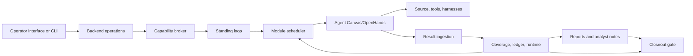

# REFALL AB architecture map

REFALL AB connects an operator workbench, backend control services, a persistent research loop, specialist execution, and analysis resources.
The subject workbench is the common state boundary.
Read [Research architecture](research-architecture.md) for the design rationale.
Read the [Technical codex](codex.md) for the implementation path.

## Components

| Component | Location | Responsibility |
| --- | --- | --- |
| Operator interface | `arcticbase/frontend/src/lib/refall/` | Context, scope, research controls, evidence, decisions, and closeout views. |
| Backend operations | `arcticbase/backend/src/arctic_base/api/refall_ops_commands.py` | Context writing, readiness, authorized lifecycle, and report operations. |
| Coverage and finding store | `arcticbase/backend/src/arctic_base/refall/coverage_store.py` | Units, leases, determinations, findings, receipts, pending actions, and capabilities. |
| Ledger | `arcticbase/backend/src/arctic_base/refall/ledger.py` | Persistent evidence and decision entries. |
| Runtime storage | `arcticbase/backend/src/arctic_base/refall/runtime_state.py` | Events, observations, retries, artifacts, manifests, and checkpoints. |
| Standing loop | `ref_all_executor/standing_loop.py` | Scheduling, task construction, polling, ingestion, recovery, and report cadence. |
| Module registry | `ref_all_executor/work_modules.py` | Subject-specific task declarations and per-target dependencies. |
| Agent execution | Agent Canvas/OpenHands | Specialist conversations and their execution workspaces. |
| Report pipeline | `ref_all_executor/report_*.py` | Drafting, enrichment, current-object updates, and replacement protection. |
| Standalone research | `drive_research.py`, `drive_bin*.py` | Source and compiled-binary investigation drivers. |
| Compatibility coverage | `coverage_service/` | Standalone coverage service, investigation tools, and reusable source or binary helpers. |
| Analysis toolchain | `toolchain/` | Source tools, indexes, graphs, metrics, and optional MCP services. |

The backend implementation retains the ArcticBase name in paths and process names.
The product name is REFALL AB.

## Service flow

## State ownership

### Workbench metadata and objects

The backend stores the subject identity, source path, display theme, custom module settings, and report pointer.
Objects hold context, HTML reports, uploaded material, and published artifacts.
`refall_current_report_object_id` identifies the current report explicitly.

### Coverage storage

`refall_coverage.db` stores coverage units, evidence anchors, finding state, transition receipts, pending actions, capabilities, and supporting research records.
A coverage unit includes ownership, lease expiry, summary, sensitivity, touched data, flows, and leads.
Coverage percentages summarize recorded unit state.

### Evidence ledger

`refall_ledger.jsonl` stores facts, leads, findings, validation, artifacts, and important decisions.
Entries identify the workbench and relevant task or lane.
This ledger is distinct from the runtime database and agent conversation archive.

### Subject runtime

`.refall/runtime/state.sqlite` stores events, sessions, observations, retry state, artifacts, manifests, and checkpoints.
`.refall/runtime/artifacts/` holds artifact content.
Runtime projections expose observations, evidence relationships, and nonfatal errors through workbench APIs.

### Scheduling state

`.refall/loop_state.json` preserves active conversations and iteration state.
`.refall/module_progress.json` preserves completed passes and known targets.
`.refall/blackboard.json` provides compact shared notes.
These records support continuation without making a conversation transcript the research database.

## Research work and provider roles

The manager examines context, resources, unresolved work, and current proof.
The standing loop turns that state into bounded assignments.
Claude and Codex use configured ACP lanes through Agent Canvas.
The optional Grok role is controlled by the host manager in a separate sandbox.

The module registry can combine source understanding, security review, research, development, static analysis, and dynamic examination.
Each module has a target source and optional local dependencies.
The scheduler prioritizes pending actions, subject setup, fresh breadth, finding work, and later unit passes.

## Control points

Source projection prepares the configured container location and reports existing mount permissions.
Inventory records content identity rather than preventing file access.
The capability broker evaluates presented action requests against grants.
Backend Start and Update enforce a refusal before loop process release.
The generic authorization route returns a decision without executing the command.

Grant and revoke authentication requires `REFALL_CAPABILITY_OPERATOR_TOKEN_PATH`.
The unset default retains caller-supplied grantor identities.
Task context supplies scope guidance; Agent Canvas and deployment permissions supply the execution boundary.
The promotion gate checks candidate evidence, source identity, and external scope.
The disposition gate checks finding transitions and typed receipts.
The closeout gate checks the persistent campaign state and report freshness.

These control points govern different transitions.
A successful process launch does not establish a valid finding.
A valid finding does not establish that the campaign is complete.
Draft report objects can exist before the closeout gate passes.
Read [Control in depth](control-in-depth.md) for action gates, record gates, guidance, observations, and explicit exceptions.

## Recovery and publication

HTTP retries handle transient service failures.
Terminal handling classifies the invocation and preserves output before handling failure or scheduling retry.
Checkpoints and manifests connect resumed work to source and configuration identities.
The watchdog and supervisor expose stalled or degraded execution and bounded recovery.

Draft and enrichment stages compile stored evidence.
A replacement guard protects populated architecture, methods, and flow sections.
Closeout then reports blocking obligations and advisory warnings separately.

## Additional references

- [Feature catalog](features.md).
- [End-to-end workflows](end-to-end.md).
- [Work modules](work-modules.md).
- [API reference](api.md).
- [Evidence requirements](evidence.md).
- [Configuration](configuration.md).
