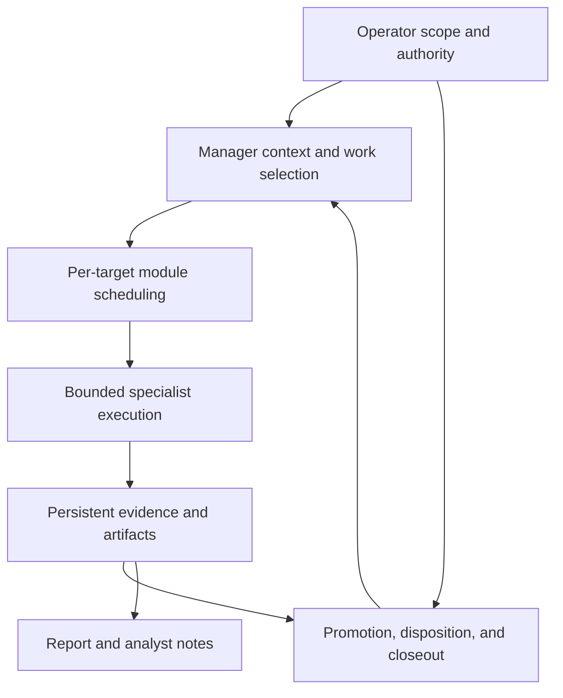

# REFALL AB research architecture

## The problem the architecture addresses

A long research campaign can outlive the conversations that produced its observations.
Different workers can examine related code, repeat earlier work, or disagree about what a result proves.
A final report then needs an explanation of scope, method, evidence, and unfinished obligations.

REFALL makes the campaign a persistent system of records.
The subject owns the evidence.
Workers receive bounded assignments and return material that the system can store, compare, and review.
The operator retains decisions about scope, live authority, exceptions, and completion.

## Three cooperating planes

### Direction and authority

The operator defines the subject, objective, scope, available resources, and necessary approvals.
The manager generates context, selects work, examines progress, and resolves questions.
The capability broker evaluates the action requests that pass through its route.
The disposition and closeout gates evaluate research decisions and completion state.

### Execution

The standing loop creates bounded tasks and dispatches configured specialists through Agent Canvas/OpenHands.
Source tools, decompilers, harnesses, and remote resources supply the relevant examination surface.
The selected module determines the purpose of a pass.
The execution environment determines the process and container boundary.

### Persistent evidence

The backend stores inventory, coverage, ledger entries, findings, pending actions, capability records, runtime state, artifacts, and report metadata.
These records provide input to the next task and the next manager session.
The report is a compiled view of this research state.

## Ready Armor and control in depth

Ready Armor public architectures separate what an agent can reason about from what it can authorize.
They also separate an agent's action from the evidence supporting its claim.
REFALL expresses these principles at the research campaign level.

| Concern | REFALL mechanism |
| --- | --- |
| What is the assignment? | Stored context, scope overlay, target identity, and module objective. |
| Who owns the work? | Coverage claims, pending-action leases, and active task state. |
| What action is authorized? | Scoped capability grants and explicit authorization requests. |
| What was observed? | Facts, flows, artifacts, and source-backed determinations. |
| What conclusion is supported? | Finding promotion checks, quality tiers, and typed transition receipts. |
| What remains unfinished? | Pending actions, refused transitions, validation state, and closeout checks. |
| What survives the worker? | Workbench state, archived events, analyst notes, and reports. |

BRA's public architecture focuses on governed assessment execution and materialization.
ARA's public architecture focuses on agent runtime policy, engagement composition, procedures, and claim provenance.
REFALL focuses on work allocation, research continuity, evidence compilation, report updates, and checked campaign closeout.

The systems share design ideas while retaining separate implementations.
REFALL's scheduler, submission parser, ledger, capabilities, and gates are implemented in this repository.
Its runtime does not import the ARA or BRA policy engines.
A subject-specific ARA mapping contract treats ARA as examined software rather than a runtime dependency.

### Build the control stack from actual boundaries

The lowest REFALL operation prepares resources for the configured execution environment.
Source projection validates the input directory and destination subject name.
It reuses an existing mount or copies source into the container.
The existing mount supplies its actual write restrictions.
The copy fallback creates an ordinary container directory.

Inventory then records content identity and source relationships.
This record supports later membership and freshness decisions.
It does not intercept file access, and an off-root file symlink can still supply inventory content.

The capability broker evaluates requests presented to it.
Backend lifecycle operations use that result before loop process release.
A refused launch request produces HTTP 403 before the process starts.
The general authorization route only returns and records its decision.
Other callers must obey that decision before they execute an operation.

Grant and revoke authentication activates with `REFALL_CAPABILITY_OPERATOR_TOKEN_PATH`.
Without that setting, the routes retain supplied identities and do not authenticate an operator token.
The matcher compares declared requester and grantor strings.
Deployment access control and protected credentials establish the actual operator boundary.

Task selection adds a different control.
Dependencies, target progress, applicable path filters, and concurrency rules select later work.
Fresh breadth uses direct coverage claims and the global conversation limit.
Scope and workspace statements in an objective are instructions to the model.
Iteration limits are conversation parameters sent to Agent Canvas.
The execution environment supplies the actual filesystem, process, network, and tool permissions.

Continuous capture observes execution and preserves material for subsequent decisions.
Finding admission checks evidence references, available inventory membership, and explicit external-target scope.
Typed transitions require the appropriate receipt before selected status and quality changes.
These are record gates after worker activity; they do not retroactively prevent a tool action.

Closeout checks whether campaign records support a closed lifecycle result.
Draft and current report objects can already exist when closeout remains blocked.
An explicit exception can make identified failed checks nonblocking while preserving the decision record.
The override route records a supplied operator identity without the capability-token authentication dependency.

This stack separates action release, assignment, guidance, observation, and record acceptance.
An operator can therefore identify the control that refused a request and the authority needed for a different decision.
Read [Control in depth](control-in-depth.md) for the complete layer model and a worked refusal sequence.

Public background: [BRA architecture preview](https://github.com/GainSec/BattleReadyArmor-PublicPreview), [ARA architecture teaser](https://github.com/GainSec/AgentReadyArmor-Teaser).

## Breadth and depth are distinct research work

An inventory gives the campaign a measurable starting surface.
Characterization records what a unit does and the evidence for that description.
Deeper passes can then trace behavior, review trust boundaries, construct harnesses, or verify findings.

The module scheduler prioritizes fresh coverage before repeated deep work on an initial subset.
Per-target dependencies still preserve meaningful order within each component.
This combination makes broad examination visible while retaining a route to deeper proof.

Recorded coverage is a progress measure.
A high percentage does not establish that every behavior is correct or that every possible vulnerability was found.
Findings require their own evidence and disposition checks.

## Knowledge accumulates in several forms

A fact describes an observation.
A flow describes a relationship between components or data locations.
A lead identifies a concrete question and next step.
A finding states a supported security issue.
A determination summarizes a coverage unit's role, sensitivity, data, and connections.

Artifacts preserve material that would be costly to regenerate.
Examples include disassembly, extracted metadata, graph output, traces, payloads, and screenshots.
The blackboard gives later tasks compact shared context.
Analyst notes retain the evolving architecture and research narrative.

These forms answer different questions.
Keeping them separate prevents an open hypothesis from becoming a validated finding through repeated summarization.
It also lets architecture mapping produce useful output without manufacturing vulnerabilities.

## Completion is a transition

A worker's termination is an execution event.
It is not sufficient evidence that its assigned research is complete.
REFALL first classifies the invocation and parses its result.
After the submission identity check, it preserves observations before handling the classified outcome.

Structured result validation checks the output envelope and evidence references.
Coverage completion requires the appropriate characterization result.
A subject module without canonical observations remains unfinished.
Capability and scope blocks create operator-visible obligations.

The same principle applies to findings.
A false-positive decision, duplicate decision, downgrade, or deferred chain needs a typed receipt.
A supported primitive can remain preserved even when standalone exploitability has not been demonstrated.

## Source identity matters across time

The source inventory binds observations to paths and content hashes.
A disposition receipt can identify the exact source or configuration bytes that support it.
Resume checkpoints record input hashes alongside stage status.
The manifest links the active run to inventory and scope records.

This is useful when code changes during an extended campaign.
It gives the manager a basis for distinguishing old proof from current material.
The current report freshness check also compares publication time with the evidence trail.

## Resources are selected for the subject

The core supplies task generation, result contracts, persistent state, and publication.
A subject supplies its source, scope, module configuration, available tools, and necessary execution harnesses.

Source projects can use structural search, semantic navigation, symbol indexes, graphs, and complexity measurements.
Binary projects can use decompilation, cross-references, function investigations, and runtime proof.
Hardware or platform-specific work requires a configured execution surface and subject harness.

Module declarations add research intent and selection rules.
Service definitions add managed tools.
Capability grants add authority for specified actions.
These are separate configuration decisions.

## Models remain execution resources

Task routing distinguishes reasoning, implementation, review, and verification work.
Lane patterns can distribute configured provider capacity.
Bounded retries can switch providers when a recoverable worker failure prevents a usable result.

The shared workbench remains the source of research continuity.
Replacing a model does not replace the subject inventory, evidence identifiers, pending obligations, or current report.
The optional Grok configuration uses a host-managed sandbox with a separate material boundary.
Its accepted output returns through the manager.

## Evidence graphs and analysis graphs

The runtime evidence graph relates stored observations and artifact references.
It supports review of where claims and outputs came from.
Call graphs, dependency graphs, and property graphs describe the examined software.
They are generated by the selected analysis tools.

The two graph families complement each other.
An analysis graph can explain a code path.
The evidence graph can connect that analysis artifact to the research record and resulting conclusion.
Neither relationship substitutes for the proof required by a finding's transition.

## Reports are maintained research products

A formal report presents findings, methods, scope, proof, limitations, and remediation.
A debrief presents progress, decisions, blockers, and next actions.
Analyst notes preserve an evolving technical explanation while the research continues.
Visual evidence makes selected paths, relationships, and observed effects easier to examine.

Report generation reads persistent research state.
Replacement checks protect populated technical sections from accidental loss.
The closeout gate distinguishes unresolved completion barriers from advisory warnings.
The operator can therefore see both the campaign result and the conditions under which it was accepted.

## Implementation map

| Principle | Implementation |
| --- | --- |
| Bounded work and local dependencies | [Module scheduler](../ref_all_executor/work_modules.py) |
| Evidence before completion | [Terminal result processing](../ref_all_executor/standing_loop.py#L1378) |
| Input identity | [Source inventory](../ref_all_executor/source_inventory.py) |
| Scoped authority | [Capability broker](../arcticbase/backend/src/arctic_base/refall/coverage_store.py#L1458) |
| Decisions with receipts | [Finding transitions](../arcticbase/backend/src/arctic_base/refall/coverage_store.py#L1008) |
| Persistent continuity | [Runtime state](../arcticbase/backend/src/arctic_base/refall/runtime_state.py) |
| Preserved publication detail | [Report assembly](../ref_all_executor/report_assemble.py) |
| Explicit completion | [Closeout gate](../arcticbase/backend/src/arctic_base/refall/closeout_gate.py) |
