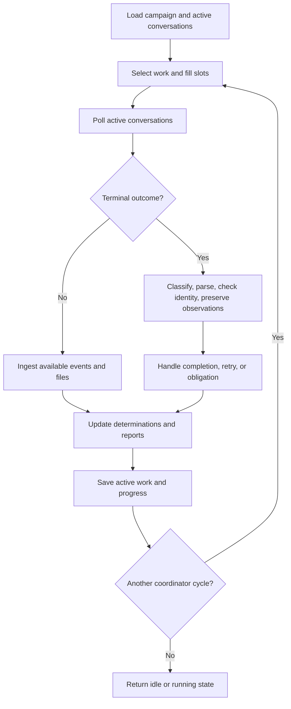
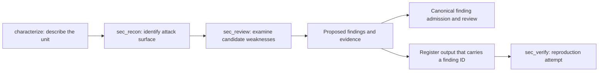
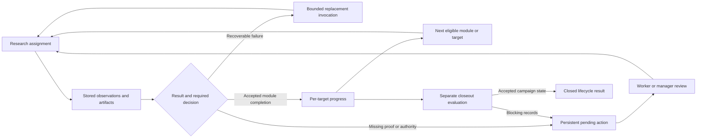

# REFALL AB research cycles

REFALL coordinates a campaign through repeated scheduling cycles and bounded worker conversations.
The campaign owns the context, evidence, progress, findings, and unresolved decisions.
A worker owns one assignment for one conversation.

These loops have different purposes.
A scheduling cycle examines available work and running conversations.
A module pass examines a particular subject, unit, or finding.
A retry attempts to repair a failed invocation.
Report and supervision cycles examine the accumulated campaign state.

## Campaign, cycle, and conversation

| Term | Meaning |
| --- | --- |
| Campaign | Persistent research state for a subject workbench. |
| Standing loop | The coordinator that selects, dispatches, polls, and records work. |
| Scheduling cycle | One complete pass through the coordinator's main loop. |
| Worker conversation | A bounded request sent to Agent Canvas/OpenHands. |
| Module pass | A declared research activity on one target. |
| Retry | A replacement conversation for the same assignment after a recoverable failure. |
| Pending action | A stored obligation with a status, owner, and applicable receipt requirements. |
| Closeout | A separate decision about whether campaign records support completion. |

The default coordinator has no fixed cycle limit: `max_cycles=0`.
It still returns when its idle conditions are met.
It does not wait indefinitely for an operator to add future work.

A finite cycle limit bounds coordinator passes.
It does not cancel every conversation when the limit is reached.
The coordinator can return `running` with active conversations saved for continuation.
The backend Update operation requests one coordinator cycle.
Its Start operation requests an unrestricted cycle count.

Source: [standing-loop execution](../ref_all_executor/standing_loop.py#L442), [backend Start and Update](../arcticbase/backend/src/arctic_base/api/refall_ops_commands.py#L266).

## One scheduling cycle

Startup loads saved active conversations, the iteration count, and campaign progress.
The coordinator loads source identity and performs applicable resume checks.
A returned preflight refusal for saved active work produces `resume_blocked` before new scheduling.
When coverage is empty, source enumeration can establish the initial units.
The loop then records its running manifest.

Each cycle performs this sequence:

1. Read coverage and gate state.
2. Fill available worker slots according to scheduling priority.
3. Poll every active conversation, including newly dispatched workers.
4. Process terminal outcomes or ingest available output from running workers.
5. Update determinations and applicable reports.
6. Consider report and visualization workers.
7. Save active conversations, cycle state, and progress.
8. Evaluate the cycle limit, stall condition, and idle conditions.
9. Wait for the configured poll interval when another cycle is needed.

Global parallelism defaults to four conversations.
The poll interval defaults to five seconds.
These are coordinator settings rather than a guarantee about every tool process that a worker can create.

A terminal conversation increments the loop's `completed` counter.
That counter includes failed conversations.
Use coverage, module progress, finding state, and pending actions to assess research completion.

Source: [cycle body and return conditions](../ref_all_executor/standing_loop.py#L442).

## What receives the next available slot

The scheduler uses this priority order:

| Priority | Work | Selection rule |
| --- | --- | --- |
| 1 | Worker-claimable pending actions | Claim eligible open actions or expired leases. |
| 2 | Requested threat-model work | Require the necessary context and inventory inputs. |
| 3 | Subject modules | Select eligible identification, research, toolchain, or synthesis work. |
| 4 | Fresh coverage | Claim an open or expired coverage unit for characterization. |
| 5 | Finding modules | Select verification or patch work for registered finding targets. |
| 6 | Later unit modules | Deepen units already recorded as characterized. |

Priority applies whenever the coordinator selects another task.
A worker already running a lower-priority assignment is not interrupted merely because higher-priority work appears.

Subject modules can run before fresh coverage.
Their own local priority determines which eligible subject module is selected.
A subject synthesis module therefore does not automatically wait for all unit review work.
Declare the intended prerequisites rather than treating pack names as global phases.

Fresh coverage precedes finding modules and later unit passes.
This spreads initial examination across available source units before repeated depth on an early subset.
Pending actions still provide a route to urgent validation before ordinary breadth.

Source: [dispatch priority](../ref_all_executor/standing_loop.py#L590), [module selection](../ref_all_executor/work_modules.py#L460).

## Pending work is a queue with ownership

Pending selection accepts open actions and claimed actions whose leases have expired.
It orders candidates by priority, action kind, and recorded time.
At equal priority, live validation precedes an ordinary operator-decision action.

Some obligations remain manager work.
The worker selector excludes watchdog-stop reviews.
It also excludes specified finding-promotion reviews that require manager examination or identify an inventory mismatch.
The operator can still see these obligations even when workers have nothing eligible to claim.

A pending-action worker receives the obligation and its required result.
Successful processing attempts to resolve it through the pending-action API.
Required receipt types and evidence still apply at that API boundary.
An unresolved action can remain a closeout blocker after the coordinator becomes idle.

Coverage claims have a separate lease.
The backend selects open units or expired claims and updates ownership within a database transaction.
The default coverage lease is 900 seconds.
An expired claim makes the unit eligible for another claim; it is not successful completion.

Sources: [pending selection](../ref_all_executor/standing_loop.py#L1987), [worker exclusions](../ref_all_executor/standing_loop.py#L3451), [coverage claims](../arcticbase/backend/src/arctic_base/refall/coverage_store.py#L390).

## Depth develops per target

Module dependencies apply to the same target.
A completed pass on `parser.py` does not satisfy a dependency for `writer.py`.
The scheduler stores completed module identifiers separately for each target.

With no explicit module configuration, the registry selects `security_assessment`.
Its dependency resolution also loads baseline characterization.
The built-in source sequence is:

Characterization records the unit in scheduler progress and unlocks dependent passes.
Coverage submission has its own acceptance branch.
Module progress and recorded coverage therefore answer different questions.

Other packs add different paths:

| Pack | Built-in target path |
| --- | --- |
| `reverse_engineering` | Subject identification; unit characterization → decomposition → review. |
| `security_assessment` | Characterization → reconnaissance → review; finding verification. |
| `dynamic_testing` | Characterization → harness drafting → runtime verification. |
| `development` | Characterization → harness drafting; finding patch proposal. |
| `static_analysis` | Subject toolchain work; characterization → unit review. |
| `research` | Subject research and subject synthesis, selected by their local priorities. |

Eligible later passes apply completed-work checks, dependencies, active-target checks, applicable path filters, and module concurrency.
Fresh characterization uses direct coverage claims instead of that eligibility function.
It attaches the first active breadth module and uses the fixed `characterize` task class.
Later unit selection supplies the recorded path but does not supply `unit_state`.
Read [Work modules](work-modules.md) for the configuration fields and their actual selection branches.

Sources: [built-in packs](../ref_all_executor/work_modules.py#L123), [default registry](../ref_all_executor/work_modules.py#L217), [per-target progress](../ref_all_executor/work_modules.py#L426), [eligibility](../ref_all_executor/work_modules.py#L333).

## Findings create another research frontier

Finding modules operate on registered finding identifiers.
The scheduler retains a compact identifier, path, and title for each such target.
Completion processing registers finding outputs that contain identifiers.
A finding also has canonical evidence, validation, and disposition records outside this scheduling index.
Registration in that compact index does not establish that the canonical finding admission gate accepted the candidate.

`sec_verify` asks a worker to attempt reproduction.
Its requested result includes exact steps, expected behavior, observed behavior, and proof status.
`dev_patch` asks for a minimal, verifiable proposed change.
Those objectives define assignments; they do not prove reproduction or apply a patch automatically.

When both built-in finding modules are eligible, verification has priority 20 and patch work has priority 70.
The built-ins do not declare a patch-to-verification dependency.
A patch proposal therefore does not automatically reopen the completed verification module.
Use an explicit pending action or a distinct configured verification pass for another examination.

A proposed finding status or quality change passes through typed transitions.
Live validation, false-positive decisions, duplicates, downgrades, and deferred chains require their respective receipts.
A refused transition preserves the existing finding state and records the refusal.
Research can continue while the missing proof or decision remains visible.

Sources: [finding registration and selection](../ref_all_executor/work_modules.py#L435), [finding assignment](../ref_all_executor/standing_loop.py#L744), [transition application](../ref_all_executor/standing_loop.py#L2889), [disposition gate](../arcticbase/backend/src/arctic_base/refall/coverage_store.py#L1008).

## Evidence arrives before an assignment is complete

Running conversations can contribute facts, leads, findings, flows, and saved artifacts.
The loop reads conversation events and workspace submission files during polling.
Stable identities prevent repeated ingestion from producing the same stored observation repeatedly.
A failed backend write remains eligible for a later persistence attempt.

Terminal handling uses a specific order:

1. Classify the invocation status and terminal submission contract.
2. Parse the output and assignment metadata.
3. Check whether the structured submission was already applied.
4. Preserve available research observations.
5. Handle the classified completion, failure, retry, or operator obligation.

A duplicate applied submission returns before terminal salvage.
For other terminal results, salvage precedes failure handling and retry dispatch.
A failed conversation can therefore retain useful research without receiving successful assignment completion.

The successful branch applies proposed transitions and persists control requests.
Coverage submission additionally requires the exact `finished` status, a characterization task, and an eligible parsed coverage result.
Later modules do not resubmit breadth coverage.

The empty-output guard applies to module tasks that carry no unit record.
It requires canonical facts, leads, findings, or flows and successful persistence before module completion.
The current subject and finding dispatch shapes use that guard.
A completion message alone does not satisfy it.

Sources: [incremental ingestion](../ref_all_executor/standing_loop.py#L1115), [terminal processing](../ref_all_executor/standing_loop.py#L1378), [empty-output guard](../ref_all_executor/standing_loop.py#L1161).

## Repetition, retry, and exhaustion

Built-in modules normally use `once_per_target=true`.
A completed module is then excluded for that target.
The active-target check also avoids another instance of that same once-per-target pass while it runs.

Setting `once_per_target=false` removes those particular exclusions in eligible module selection.
Such subject, finding, or later unit passes can become eligible repeatedly.
Dependencies, applicable filters, and concurrency settings still affect selection.
This is an explicit repeated-work configuration rather than an automatic new research hypothesis.

Invocation retry is a separate mechanism.
The classifier defaults to two total attempts for recoverable worker failures.
Strict terminal-contract refusal requires `REFALL_REQUIRE_STRUCTURED_SUBMIT=true`; that setting defaults to false.
Claude lane A can fail over to Codex lane B; lane B remains on B.
The replacement retains the assignment, module target, and accumulated campaign evidence.

Recognized capability, scope, operator-stop, and tool-execution failures do not use ordinary automatic retry.
Capability failures create an access request and decision obligation.
Scope failures create an obligation requiring a scope decision receipt.
Other exhausted or nonretryable outcomes produce manager-visible review work.

A failed module does not receive successful progress merely because its retry budget ended.
It can remain eligible for later scheduling.
An expired coverage lease can also expose the original unit again.
The invocation retry limit therefore bounds that replacement chain, not every future campaign assignment for the same target.

Sources: [eligibility and repetition](../ref_all_executor/work_modules.py#L333), [failure classification](../ref_all_executor/runtime_invocation.py#L23), [replacement dispatch](../ref_all_executor/standing_loop.py#L2720), [decision obligations](../ref_all_executor/standing_loop.py#L2837).

## Reports and visuals have their own cadence

The default draft refresh interval is ten coordinator cycles.
Ordinary assessment refresh requires at least one finding ledger entry.
Mapping-mode refresh can instead use recorded facts, leads, flows, or artifacts.

A report-writing conversation uses a different trigger.
By default, it needs an available slot, the source-coverage completion predicate, and 30 new facts, leads, or findings.
That predicate compares completed and total file counts when both are available.
If those counts are absent, it returns true.
A nonpositive report threshold disables the default report-worker trigger.

The optional continuous report policy reserves one slot and replaces completed report workers without the default volume trigger.
This policy can keep reporting activity available after ordinary analysis work is exhausted.

Visualization is considered every 20 cycles.
It requires the source-coverage predicate, an available slot, and the configured resolved-coverage threshold.
The default threshold is 25 percent.
Ordinary assessment also requires three finding entries; mapping mode uses its separate objective without that finding-count condition.

| Worker request | Default iteration limit |
| --- | --- |
| Characterization, subject modules, finding modules, and later unit passes | 30 |
| Report worker | 25 |
| Visualization worker | 20 |
| Replacement retry | 30 |

These limits are sent to Agent Canvas with the conversation request.
They do not establish campaign closeout or a host-wide resource ceiling.

Sources: [draft cadence](../ref_all_executor/standing_loop.py#L1769), [report-worker trigger](../ref_all_executor/standing_loop.py#L1804), [visualization trigger](../ref_all_executor/standing_loop.py#L1919), [conversation request](../ref_all_executor/oh_client.py#L89).

## Idle, stalled, supervised, and closed

An idle coordinator has no active conversations under its return conditions.
The loop also examines remaining module work and worker-claimable pending actions before an idle exit after dispatch activity.
Idle does not mean that every obligation is resolved.
Manager-only actions, refused transitions, or missing report proof can still block closeout.

The stall check measures cycles since the most recent terminal conversation.
Its default threshold is 36 cycles, with a strict greater-than comparison.
A terminal failure updates that completion clock too.
The threshold is therefore not a measure of scientific progress or successful proof.
A stall return can retain active conversations and report `running`.

The watchdog supplies another observation and response cycle.
It samples services, active conversations, progress signatures, reported usage, and failure signals.
With enforcement active, selected conditions can delete a managed conversation and create stop-review records.
Its sampled thresholds are separate from per-conversation iteration limits.

The watchdog also examines resource requests in the wishlist.
It can recognize an already installed tool or use a configured allowlisted installer when installation is enabled.
Unsupported or failed requests remain reported as unhandled work.
A wishlist record does not itself grant live execution authority.

The supervisor has fast liveness and full watchdog/status modes.
Its default cron entries request a fast pass each minute and a full pass every three minutes.
Service recovery can restart the configured backend or Agent Canvas.
An absent loop with otherwise healthy services is reported as idle; that branch does not automatically launch a new research loop.
Repeated service recoveries can trigger a hold and stop the coordinator process until an operator clears the fault.

Closeout remains a separate operation.
It checks pending actions, finding proof, transition receipts, expired claims, stored context, and report freshness.
Coverage below the default 95-percent threshold is advisory rather than blocking.
The manager can resolve the underlying work or record an explicit, receipted exception for identified checks.
Read [Control in depth](control-in-depth.md) for the gate and authority boundaries.

Sources: [return and stall conditions](../ref_all_executor/standing_loop.py#L442), [watchdog pass](../ref_all_executor/watchdog.py#L658), [wishlist handling](../ref_all_executor/watchdog.py#L903), [supervisor tick](../ref_all_executor/supervisor.py#L561), [closeout gate](../arcticbase/backend/src/arctic_base/refall/closeout_gate.py#L14).

## Examine a campaign's next step

1. Read the stored context, scope, and source inventory.
2. Inspect active conversations and the last recorded cycle.
3. Examine worker-claimable obligations before ordinary coverage work.
4. Check remaining fresh units and expired claims.
5. Compare each target's completed modules with its dependencies.
6. Inspect finding verification, patch proposals, and required receipts separately.
7. Review failed invocations and distinguish their retry chain from later rescheduling.
8. Inspect the ledger, artifacts, determinations, and report freshness.
9. Evaluate closeout independently of the coordinator's idle or running status.

Use [End-to-end workflows](end-to-end.md) for the operating sequence.
Use [Technical codex](codex.md) for the broader implementation path.
